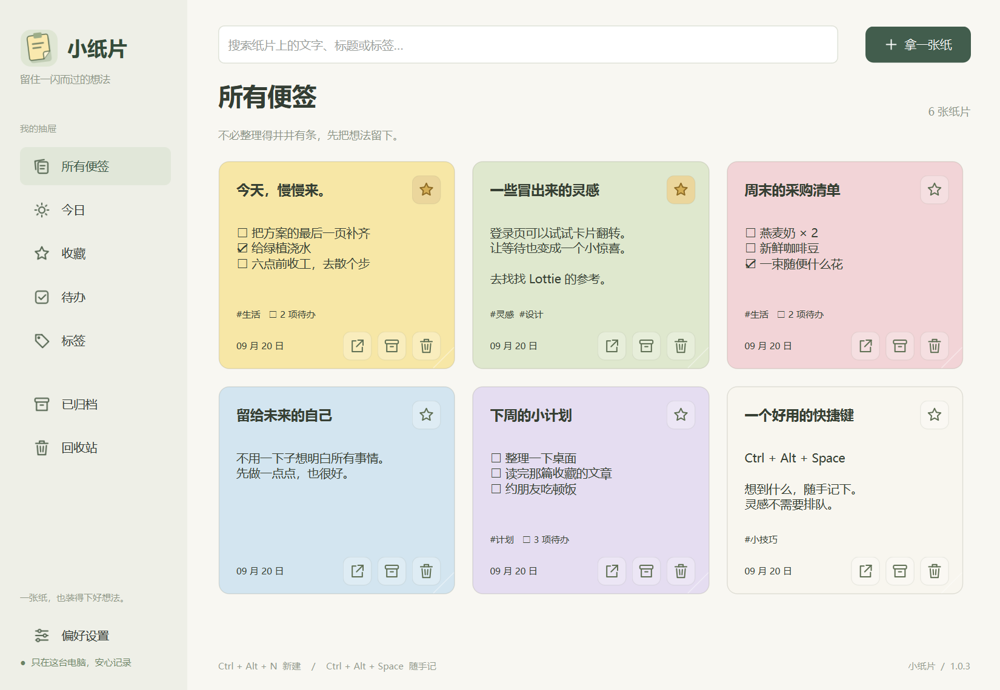

# 小纸片 · Slip of Paper

一款安静、快速、完全离线的 Windows 桌面便签工具。

它更像桌面上的一张纸，而不是复杂的笔记管理软件：按下快捷键，马上写下想法；写完离开，内容自动保存。

[English README](README_EN.md) · [使用说明](使用说明.md) · [最新 Windows 版](release/1.0.3/小纸片-Windows-x64.zip)



## 功能

- 多张桌面便签：自由拖动、调整大小、吸附边缘和相邻便签
- 自动保存：编辑、移动、缩放、换色和待办状态都会保存到本地 SQLite
- 快速输入：`Ctrl + Alt + N` 新建，`Ctrl + Alt + Space` 快速记录
- 待办和轻量格式：`[]`、`#`、`-`、分割线、粗体、删除线、高亮和链接
- 便签抽屉：搜索、收藏、标签、归档和 30 天回收站
- 桌面控制：置顶、透明度、字号、Ctrl + 滚轮调字号、放回抽屉
- Windows 托盘和全局快捷键，支持显示 / 隐藏全部便签
- 本地保护：历史版本、每日备份、导入导出和异常退出恢复
- 手绘纸张视觉：独立绘制的纸片 LOGO、线条图标和纸张纹理

## 下载和运行

推荐下载 [小纸片-Windows-x64.zip](release/1.0.3/小纸片-Windows-x64.zip)，解压后运行：

```text
release/1.0.3/小纸片/小纸片.exe
```

程序是免安装目录版。运行时请保留整个 `小纸片` 文件夹，不要只复制 exe。也可以双击仓库根目录的 `启动小纸片.cmd`。

首次启动会出现一张可以直接编辑的引导便签。程序不要求登录，不连接云端；数据默认保存在：

```text
%LOCALAPPDATA%\LittlePaper
```

## 常用快捷键

| 快捷键 | 操作 |
| --- | --- |
| `Ctrl + Alt + N` | 新建便签 |
| `Ctrl + Alt + Space` | 快速记录 |
| `Ctrl + Alt + F` | 搜索便签 |
| `Ctrl + Alt + H` | 隐藏 / 恢复全部便签 |
| `Ctrl + Alt + V` | 剪贴板文字生成便签 |
| `Ctrl + Shift + Enter` | 当前行转换为待办 |
| `Ctrl + Shift + P` | 置顶 / 取消置顶 |
| `Ctrl + Shift + Delete` | 放入回收站 |
| 悬停便签 + `Ctrl` 滚轮 | 调整当前便签字号 |
| `Esc` | 隐藏当前便签 |

便签右下角的抽屉按钮可以立即保存并把当前便签放回抽屉；之后可从「已归档」重新打开。

## 从源码运行

需要 Python 3.11 或更高版本，以及 Windows 10 1809 / Windows 11 64 位环境。

```powershell
python -m venv .venv
.\.venv\Scripts\python.exe -m pip install -r requirements.txt
.\.venv\Scripts\python.exe main.py
```

运行测试：

```powershell
.\.venv\Scripts\python.exe -m unittest discover -s tests -v
```

构建最新 release：

```powershell
.\.venv\Scripts\python.exe tools\build.py --output release/1.0.3
.\.venv\Scripts\python.exe tools\check_release.py --output release/1.0.3
```

## 项目结构

| 路径 | 作用 |
| --- | --- |
| `main.py` | 启动、单实例锁、异常日志 |
| `stickies/app.py` | 托盘、窗口生命周期和命令协调 |
| `stickies/ui.py` | 桌面便签、编辑器和纸张绘制 |
| `stickies/manager.py` | 便签抽屉、设置和快速记录 |
| `stickies/store.py` | SQLite、快照、备份、导入导出 |
| `stickies/icons.py` | LOGO 和线条图标 |
| `stickies/platform.py` | Windows 全局热键和开机启动 |
| `tests/` | 存储、编辑器、快捷键和界面测试 |

## 当前版本

1.0.3 包含桌面便签的「放回抽屉」快捷按钮。当前测试覆盖 23 项场景，包括自动保存、字体与横线对齐、Ctrl + 滚轮调字号、归档恢复、单实例、重启恢复和 SQLite 完整性检查。

当前仍未包含提醒、图片便签、OCR、云同步、Windows Hello 锁定和 AI 整理等 V2 功能。

## 许可证和第三方组件

应用源码使用本仓库中的说明文件；程序使用 Python、Qt for Python / PySide6、SQLite 和 PyInstaller。相关许可文本位于 [THIRD_PARTY_NOTICES.md](THIRD_PARTY_NOTICES.md) 和 release 包中的 `licenses` 目录。
