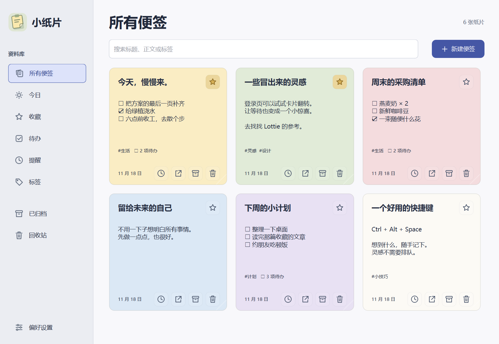
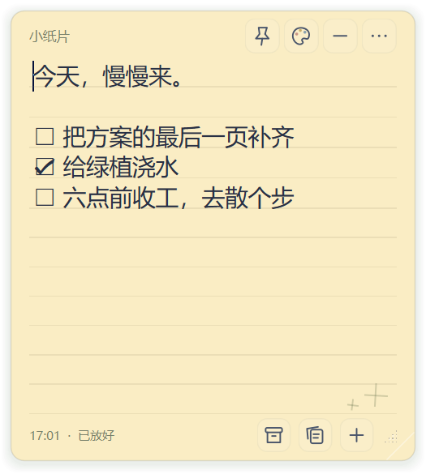
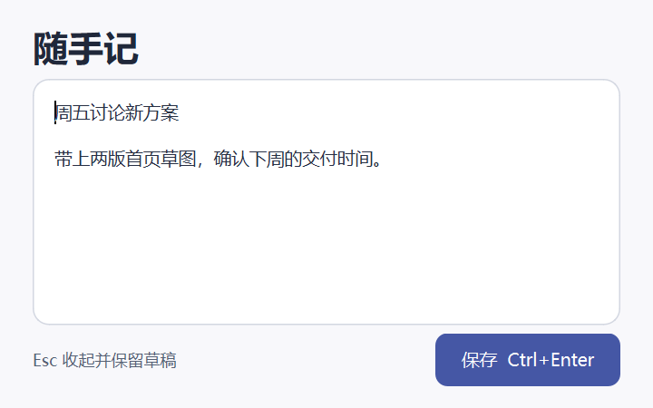
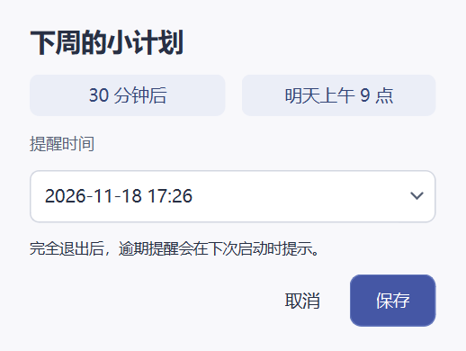
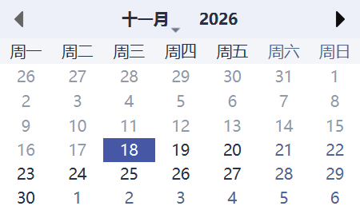
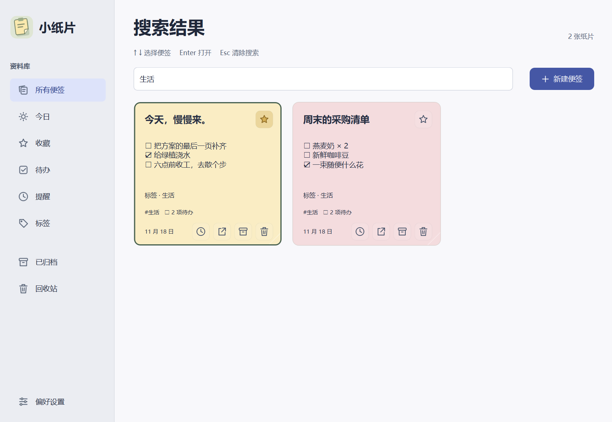
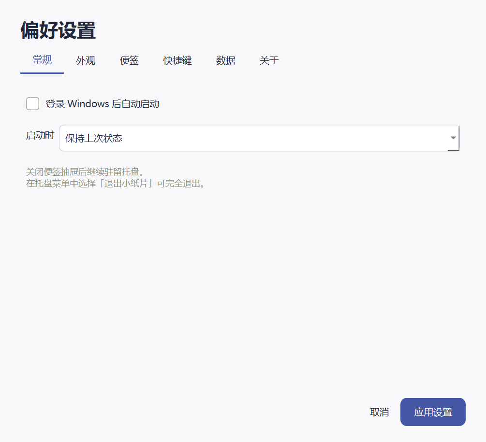

# Slip of Paper · 小纸片

A quiet, fast, fully offline sticky-note tool for the Windows desktop.

It is designed to feel like a real piece of paper rather than a heavy note-taking system: press a shortcut, write immediately, and leave without pressing Save.

[中文 README](README.md) · [User guide](使用说明.md) · [Latest Windows build](https://github.com/Flowerrr2/slip-of-paper/releases/download/v1.1.2/Slip-of-Paper-1.1.2-Windows-x64.zip)



## Screenshots

<table>
<tr><td valign="top">Desktop checklist<br></td><td valign="top">Quick capture draft<br></td></tr>
<tr><td valign="top">Set a reminder<br></td><td valign="top">Choose a date<br></td></tr>
<tr><td valign="top">Search by tag and select a result<br></td><td valign="top">Configure startup and window behavior<br></td></tr>
</table>

## Features

- Multiple desktop notes with drag, resize, edge snapping, and neighbor snapping
- Local SQLite autosave for text, movement, resizing, colors, and todo state
- Fast capture: `Ctrl + Alt + N` for a new note and `Ctrl + Alt + Space` for quick capture
- Lightweight formatting: `[]`, `#`, `-`, dividers, bold, strike-through, highlight, and links
- A note drawer with search, favorites, tags, archive, and a 30-day recycle bin
- Pinning, opacity, font-size controls, Ctrl + mouse-wheel font sizing, and “put back in drawer”
- Windows tray integration and global shortcuts for showing or hiding all notes
- Local safeguards: version snapshots, daily backups, import/export, and crash recovery
- One-time local reminders from desktop notes and drawer cards
- Hand-drawn paper visual language with a custom paper logo, line icons, and ruled paper

## Download and run

Download [Slip-of-Paper-1.1.2-Windows-x64.zip](https://github.com/Flowerrr2/slip-of-paper/releases/download/v1.1.2/Slip-of-Paper-1.1.2-Windows-x64.zip), extract it, and run:

```text
小纸片/小纸片.exe
```

This is a portable folder build. Keep the complete `小纸片` folder together; do not copy only the executable. You can also double-click `启动小纸片.cmd` in the repository root.

The first launch includes an editable welcome note. No account or network connection is required. Data is stored locally at:

```text
%LOCALAPPDATA%\LittlePaper
```

## Common shortcuts

| Shortcut | Action |
| --- | --- |
| `Ctrl + Alt + N` | Create a note |
| `Ctrl + Alt + Space` | Open quick capture |
| `Ctrl + Alt + F` | Search notes |
| `Ctrl + Alt + H` | Hide / restore all notes |
| `Ctrl + Alt + V` | Turn clipboard text into a note |
| `Ctrl + Shift + Enter` | Convert the current line to a todo |
| `Ctrl + Shift + P` | Pin / unpin the note |
| `Ctrl + Shift + Delete` | Move the note to the recycle bin |
| Hover a note + `Ctrl` mouse wheel | Change the current note’s font size |
| `Esc` | Hide the current note |

The drawer icon in the bottom-right corner immediately saves and archives the current note. It can be reopened from the “Archived” section.

## Run from source

Python 3.11+ and a 64-bit Windows 10 1809 / Windows 11 environment are recommended.

```powershell
python -m venv .venv
.\.venv\Scripts\python.exe -m pip install -r requirements.txt
.\.venv\Scripts\python.exe main.py
```

Run the test suite:

```powershell
.\.venv\Scripts\python.exe -m unittest discover -s tests -v
```

Build and smoke-test the latest release:

```powershell
.\.venv\Scripts\python.exe tools\build.py --output release/1.1.2
.\.venv\Scripts\python.exe tools\check_release.py --output release/1.1.2
```

## Project layout

| Path | Responsibility |
| --- | --- |
| `main.py` | Startup, single-instance lock, and error logging |
| `stickies/app.py` | Tray integration, window lifecycle, and command coordination |
| `stickies/ui.py` | Desktop note windows, editor, and paper rendering |
| `stickies/manager.py` | Note drawer, settings, and quick capture |
| `stickies/store.py` | SQLite storage, snapshots, backups, and import/export |
| `stickies/icons.py` | Paper logo and line icons |
| `stickies/platform.py` | Windows global shortcuts and startup registration |
| `tests/` | Storage, editor, shortcut, and UI tests |

## Current release

Version 1.1.2 refreshes the drawer, desktop notes, and quick capture. Version 1.1.0 added one-time local reminders, search excerpts, and keyboard navigation for search results. The drawer loads cards in batches as you scroll.

Recurring reminders, image notes, OCR, cloud sync, Windows Hello locking, and AI organization are planned for later versions.

## License and third-party components

The application source is accompanied by the repository documentation. It uses Python, Qt for Python / PySide6, SQLite, and PyInstaller. License notices are available in [THIRD_PARTY_NOTICES.md](THIRD_PARTY_NOTICES.md) and in the release package’s `licenses` directory.
